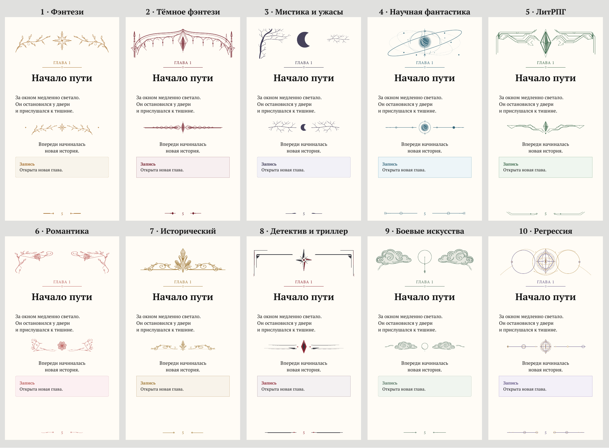

<div align="center">


# PDFMaker Mobile

**Из отдельных глав — в готовую книгу для телефона, читалки и Kindle.**

[](https://github.com/aleksandreev2/pdef/releases/latest)
[](#установка)
[](LICENSE)

**[Скачать для Windows](https://github.com/aleksandreev2/pdef/releases/latest)** ·
[Руководство](docs/guide.md) · [История версий](CHANGELOG.md) ·
[Сообщить об ошибке](https://github.com/aleksandreev2/pdef/issues/new/choose)

</div>

PDFMaker Mobile — настольное приложение команды **Дом Некроманта**. Загрузите
главы, проверьте их порядок, выберите обложку и оформление, затем сохраните
книгу в одном или нескольких форматах. Сборка выполняется на вашем компьютере.

| На входе | На выходе |
| --- | --- |
| TXT, DOCX, экспорт Google Docs, FB2, MOBI, AZW3 | PDF, EPUB 3, FB2, MOBI, AZW3, TXT |
| Отдельные файлы, папки и ZIP-архивы | Книга с оглавлением, обложкой и выбранными главами |

## Установка

1. Откройте [последний релиз](https://github.com/aleksandreev2/pdef/releases/latest).
2. Скачайте **`PDFMaker-Mobile-3.3.2-Setup.exe`** из раздела **Assets**.
3. Запустите файл. Установщик добавит приложение и ярлыки, затем откроет PDFMaker.

Поддерживаются **Windows 10 и 11, 64 бит**. В установщик входят все библиотеки,
шрифты PT Serif / PT Sans и конвертер Calibre для Kindle. Для обычной установки
не нужны Node.js, консоль или отдельные программы. После установки все шесть
форматов собираются без интернета.

> Архив `PDFMaker-Mobile-3.3.2.zip` предназначен для запуска **из исходников**.
> Для обычного использования скачайте установщик `.exe`.

## Первая книга за пять шагов

1. Перетащите главы, папку или ZIP в окно приложения.
2. Укажите название и команду перевода, выберите обложку.
3. Проверьте вкладку **«Аудит»**: порядок, дубли, пропуски и пустые файлы.
4. Выберите жанр, форматы и папку вывода. При необходимости включите сжатие
   изображений или обе версии книги: с иллюстрациями и без них.
5. Нажмите **«Собрать книгу»**, затем откройте **«Отчёт»** и **«Предпросмотр»**.

## Возможности

| Возможность | Что делает |
| --- | --- |
| Шесть форматов | Сохраняет PDF, EPUB, FB2, MOBI, AZW3 и TXT за одну сборку |
| Удобный PDF | Страницы 9:16 для телефона, выделяемый текст, ссылки, оглавление и закладки |
| Жанровое оформление | 11 профилей: от фэнтези и ЛитРПГ до романтики и эротики |
| Ручное оформление | Настройка титула и страницы «О переводе» с настоящим PDF-образцом, отменой и сбросом |
| Иллюстрации | Два режима сжатия; версия без иллюстраций или обе версии одновременно |
| Обложка | В версии без иллюстраций сохраняется по умолчанию; её можно отключить отдельно |
| Проверка глав | Предупреждения о пропущенных номерах, пустых и повреждённых файлах; поиск дублей |
| Системные записи | Читаемые карточки персонажей с выделенными полями и сохранением исходных скобок |
| Проверка результата | Структурные проверки файлов, отчёт и просмотр страниц внутри приложения |
| Обновления | Уведомление о новом релизе и скачивание установщика из приложения |

<details>
<summary><strong>Посмотреть примеры жанрового оформления</strong></summary>

Ниже — реальные страницы PDF, собранные приложением. Галерея показывает
десять базовых профилей; дополнительный профиль «Эротика» доступен с версии 3.2.0.



</details>

## Что нового в 3.3.2

Исправлены закладки в структуре PDF: выбор главы открывает её страницу.
Для уже созданных книг нужна пересборка PDF обновлённым приложением.

### Версия 3.3.1

На титульной странице PDF добавлена подпись **«Создано в PDFMaker Mobile»**
и видимый кликабельный адрес репозитория. Подпись команды перевода сохраняется;
для обеих подписей предусмотрено место даже при минимальном нижнем отступе.
Уже созданные PDF нужно пересобрать из исходников.

### Версия 3.3.0

- Уведомления о новых стабильных релизах GitHub и кнопка **«Обновить»**.
  Перед запуском установщика приложение проверяет размер файла и SHA-256.
- Сжатие иллюстраций и создание облегчённой версии книги с сохранением обложки.
- Предупреждения о пропущенных главах и пустых файлах до начала сборки.
- Улучшенное оформление записей персонажей: поля разделены, подписи выделены,
  переносы слов внутри таких записей отключены.

Подробнее — в [истории версий](CHANGELOG.md).

## Как обновляться

В версии **3.3.0 и новее** PDFMaker проверяет новые релизы при запуске и раз в
шесть часов, пока открыт. В уведомлении нажмите **«Обновить»**, подтвердите
загрузку и дождитесь установщика. Перед установкой сохраните нужные результаты:
приложение закроется. Папка вывода и настройки установленной версии сохраняются.

Можно открыть описание релиза, отложить уведомление или проверить обновления
вручную. Автоматическая проверка отключается в разделе **«Обновления»**.

Для перехода с **3.2.0 и более ранних версий** один раз установите 3.3.2
из [релизов](https://github.com/aleksandreev2/pdef/releases/latest).
Новый установщик также можно запускать вручную поверх установленной версии.

## Вопросы и ответы

<details>
<summary><strong>Нужен ли интернет? Куда отправляются книги?</strong></summary>

Интернет нужен для скачивания приложения и обновлений. Импорт, оформление
и экспорт книг выполняются локально. При проверке обновлений приложение
обращается к GitHub Releases; тексты, обложки и главы туда не отправляются.

</details>

<details>
<summary><strong>Почему приложение сообщает о пропуске главы?</strong></summary>

Проверяются номера между первой и последней включёнными главами. Том может
начинаться с любого номера. Проверьте исходники и выбранные главы; если пропуск
намеренный, можно выбрать «Собрать с предупреждениями». Замечание останется в отчёте.

</details>

<details>
<summary><strong>Чем отличается версия без иллюстраций?</strong></summary>

Убираются изображения внутри книги; текст сохраняется. Обложка остаётся
по умолчанию. Жанровые орнаменты управляются отдельной настройкой. TXT всегда
сохраняется без изображений. Подробнее — в [руководстве](docs/guide.md#иллюстрации).

</details>

<details>
<summary><strong>Можно ли импортировать защищённые книги?</strong></summary>

Книги с DRM не поддерживаются. Повреждённые или неподдерживаемые исходники
отмечаются в аудите, а остальные файлы продолжают импортироваться.

</details>

## Для разработчиков

Нужен **Node.js 20 или новее**. Готовый Windows-установщик от него не зависит.

```bash
git clone https://github.com/aleksandreev2/pdef.git
cd pdef
npm ci
npm run fonts
npm start
```

```bash
npm test       # автоматические проверки
npm run dist  # полный Windows-установщик; сборка выполняется на Windows
```

Командная строка, архитектура, сборка и проверки описаны в
[документации для разработчиков](docs/development.md).
Для предложений и изменений — [CONTRIBUTING.md](CONTRIBUTING.md).

## Лицензия и авторство

Код PDFMaker Mobile распространяется под [лицензией MIT](LICENSE).
Шрифты, Calibre, Electron и остальные библиотеки сохраняют собственные лицензии —
см. [сведения о сторонних компонентах](THIRD_PARTY_NOTICES.md).

Разработчик — **[dollar](https://ranobelib.me/ru/user/726236)**,
команда **[Дом Некроманта](https://ranobelib.me/ru/team/11969--dom-nekromanta)**.
